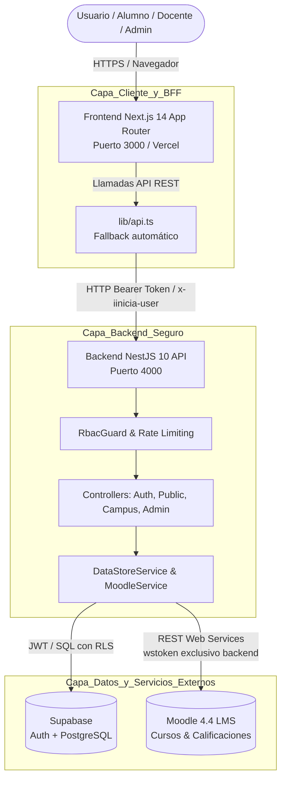
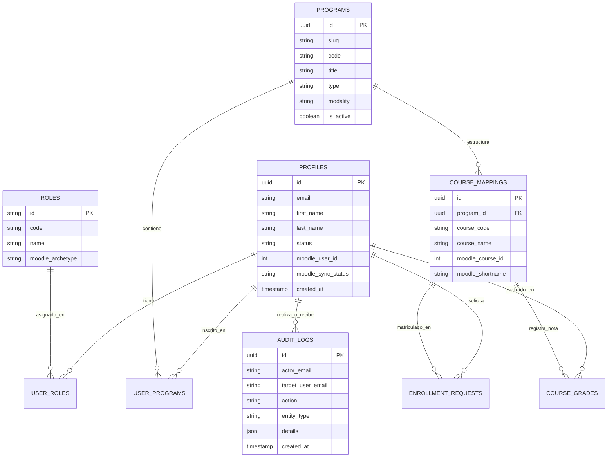

# Memoria Técnica y Documentación del Proyecto: Plataforma Digital Universitaria IINICIA

**Carrera / Área:** Ingeniería de Software y Sistemas Computacionales  
**Asignatura / Proyecto:** Proyecto Integrador de Fin de Grado / Desarrollo de Plataformas Web Corporativas  
**Proyecto:** Rediseño, Migración y Modernización del Portal Universitario IINICIA  
**Arquitectura:** Frontend Desacoplado (Next.js 14) + Backend API REST (NestJS 10) + Base de Datos e Identidad (Supabase / PostgreSQL) + LMS (Moodle 4.4 Web Services)  
**Fecha de Entrega:** Ciclo Académico 2026  

---

## Índice General

1. [Resumen Ejecutivo y Presentación del Proyecto](#1-resumen-ejecutivo-y-presentación-del-proyecto)
2. [Justificación y Problemática a Resolver](#2-justificación-y-problemática-a-resolver)
3. [Objetivos del Proyecto](#3-objetivos-del-proyecto)
4. [Arquitectura General y Decisiones de Ingeniería](#4-arquitectura-general-y-decisiones-de-ingeniería)
5. [Estructura del Repositorio (Monorepo)](#5-estructura-del-repositorio-monorepo)
6. [Módulo de Seguridad, Autenticación y RBAC](#6-módulo-de-seguridad-autenticación-y-rbac)
   - 6.1 Identidad con Supabase Auth
   - 6.2 Segundo Factor de Autenticación (2FA / TOTP)
   - 6.3 Acceso Efímero SSO al Campus (HMAC-SHA256)
   - 6.4 Matriz de Roles y Guardián RBAC
7. [Modelo de Datos y Base de Datos (PostgreSQL / Supabase)](#7-modelo-de-datos-y-base-de-datos-postgresql--supabase)
8. [Integración Servidor-a-Servidor con Moodle LMS (REST API)](#8-integración-servidor-a-servidor-con-moodle-lms-rest-api)
9. [Capa Frontend: Experiencia de Usuario, Páginas y Campus](#9-capa-frontend-experiencia-de-usuario-páginas-y-campus)
   - 9.1 Portal Institucional y Oferta Académica en Informática
   - 9.2 El Espacio "Mi IINICIA" Dinámico por Rol
   - 9.3 Aula Virtual y Campus Interactivo
   - 9.4 Panel de Administración y Bitácora de Auditoría
10. [Cuentas de Prueba Preconfiguradas](#10-cuentas-de-prueba-preconfiguradas)
11. [Guía de Instalación, Configuración y Despliegue](#11-guía-de-instalación-configuración-y-despliegue)
12. [Conclusiones y Aprendizajes Universitarios](#12-conclusiones-y-aprendizajes-universitarios)

---

## 1. Resumen Ejecutivo y Presentación del Proyecto

¡Hola a todos! Este proyecto representa el desarrollo integral de la nueva **Plataforma Digital Universitaria para la Universidad IINICIA**. 

Como estudiantes de ingeniería, nuestro reto principal fue transformar un ecosistema institucional legado (anteriormente montado en un monolito de WordPress con plugins dispersos y accesos vulnerables) en una **solución moderna, robusta, altamente escalable y desacoplada**. Diseñamos una infraestructura basada en microservicios y capas orientadas al dominio, garantizando que el portal público, la gestión de alumnos y el aula virtual operen bajo estrictas políticas de seguridad informática, accesibilidad universal y trazabilidad.

---

## 2. Justificación y Problemática a Resolver

### El problema anterior
Históricamente, muchas instituciones educativas operan con sitios monolíticos en WordPress. Esto genera múltiples cuellos de botella:
- **Acoplamiento excesivo:** El CMS institucional se mezcla con la lógica académica y de pagos.
- **Fallas de seguridad:** Fugas de credenciales, plugins desactualizados y contraseñas compartidas o enviadas en texto plano entre la web y el aula virtual.
- **Inconsistencia de datos:** Usuarios creados en un lado que no se reflejan en Moodle o generan registros duplicados con distintos correos.
- **Pobre rendimiento y nula personalización:** Interfaces pesadas, difíciles de adaptar y no optimizadas para dispositivos móviles ni normativas de accesibilidad.

### Nuestra solución
Decidimos erradicar WordPress por completo (`wordpressRemoved: true`) y separar limpiamente las responsabilidades:
1. **Frontend Institucional:** Next.js 14 con React 18, App Router, TypeScript y Tailwind CSS, enfocado en experiencia de usuario ultra rápida y diseño responsivo.
2. **Backend API:** NestJS 10 estructurado modularmente con inyección de dependencias, TypeScript y validación estricta.
3. **Identidad y Base de Datos Central:** Supabase (Auth + PostgreSQL) con políticas *Row Level Security* (RLS).
4. **Campus Virtual (LMS):** Moodle 4.4 oficial, consumido estrictamente mediante *Web Services REST* servidor-a-servidor, sin exponer tokens ni claves privadas en el navegador.

---

## 3. Objetivos del Proyecto

### Objetivo General
Desarrollar e implementar una plataforma web institucional universitaria con arquitectura desacoplada, gestión de identidades basada en roles (RBAC), autenticación en dos factores (2FA), integración automatizada con Moodle LMS y un panel administrativo con bitácora de auditoría inmutable.

### Objetivos Específicos
1. Construir un portal web moderno, accesible (WCAG 2.2 AA) y rápido, enfocado en la oferta académica de la rama de **Informática y Sistemas**.
2. Diseñar e implementar un sistema de autenticación seguro que soporte contraseñas cifradas y **TOTP (Google Authenticator RFC 6238)**.
3. Crear un backend API en NestJS que centralice la lógica de negocio, proteja los secretos institucionales y actúe como pasarela segura ante Moodle.
4. Desarrollar un mecanismo **Single Sign-On (SSO) efímero** con firmas HMAC-SHA256 (60 segundos de vigencia) para ingresar a los cursos de Moodle sin transferir contraseñas en texto claro.
5. Garantizar la regla de **gobernanza académica**: el portal no edita calificaciones directamente; Moodle es la única fuente de verdad académica.
6. Habilitar una arquitectura en modo dual (servidor dedicado con NestJS o serverless en Vercel) mediante un fallback API resiliente.

---

## 4. Arquitectura General y Decisiones de Ingeniería

El flujo de información y peticiones sigue un patrón de arquitectura limpia en tres capas:



### Reglas clave de diseño de software:
- **Mínimo Privilegio y Cero Exposición:** Ningún token de Moodle (`MOODLE_WS_TOKEN`) ni la clave de servicio de Supabase (`service_role_key`) llegan al navegador. Solo residen en el backend.
- **Gobernanza de Calificaciones:** Moodle almacena y calcula las notas de tareas y cuestionarios. El portal solo las consulta o permite al profesor calificar dentro del estándar del LMS.
- **Resiliencia de Despliegue (Modo Dual):** Si el backend NestJS local está apagado o el proyecto se sube directamente a Vercel, el frontend activa su propia ruta serverless `/api/v1/[...slug]` manteniendo el 100% de la funcionalidad activa.

---

## 5. Estructura del Repositorio (Monorepo)

El proyecto está configurado mediante *npm workspaces*, permitiendo compartir dependencias y ejecutar ambos servicios en paralelo:

```text
universidad-iinicia-main/
├── apps/
│   ├── backend/                     # Backend NestJS (Puerto 4000)
│   │   ├── src/
│   │   │   ├── controllers/         # Endpoints REST (public, auth, campus, admin)
│   │   │   ├── guards/              # RbacGuard (Validación de roles por token)
│   │   │   ├── services/            # Lógica de datos y Web Services Moodle
│   │   │   ├── types/               # Definición de interfaces y tipos de dominio
│   │   │   ├── app.module.ts        # Módulo raíz de NestJS
│   │   │   └── main.ts              # Bootstrap, CORS, Headers de seguridad y Rate Limiting
│   │   ├── package.json
│   │   └── tsconfig.json
│   │
│   └── frontend/                    # Frontend Next.js 14 (Puerto 3000)
│       ├── public/                  # Logotipos institucionales y recursos gráficos
│       ├── src/
│       │   ├── app/                 # Páginas (App Router de Next.js)
│       │   │   ├── admin/           # Panel administrativo y bitácora
│       │   │   ├── admisiones/      # Información de ingreso y requisitos
│       │   │   ├── api/v1/[...slug]/# Proxy / Servidor serverless fallback
│       │   │   ├── campus/          # Aula virtual interactiva (foros, tareas, tests)
│       │   │   ├── certificaciones/ # Certificaciones de tecnología
│       │   │   ├── contacto/        # Formulario de atención
│       │   │   ├── cursos/          # Catálogo de especialidades en TI
│       │   │   ├── diplomados/      # Diplomados profesionales
│       │   │   ├── login/           # Inicio de sesión con 2FA Google Authenticator
│       │   │   ├── mi-iinicia/      # Dashboard del estudiante, profesor o admin
│       │   │   ├── noticias/        # Blog y novedades universitarias
│       │   │   ├── oferta-academica/# Oferta académica completa y detalle por slug
│       │   │   ├── perfil/          # Edición de datos del usuario
│       │   │   ├── recuperar-acceso/# Flujo de recuperación de contraseña
│       │   │   ├── registro/        # Registro de nuevos aspirantes
│       │   │   └── universidad/     # Misión, visión e historia institucional
│       │   ├── components/          # Navbar, Footer, Logo, Reveal, CountUp
│       │   ├── context/             # AuthContext (Gestión de sesión global)
│       │   └── lib/                 # api.ts, supabase.ts, totp.ts (RFC 6238)
│       ├── package.json
│       ├── tailwind.config.ts       # Sistema de diseño con paleta institucional
│       └── vercel.json              # Configuración de despliegue en la nube
│
├── scripts/
│   └── start-all.mjs                # Script concurrente que libera puertos y arranca todo
├── vercel.json                      # Configuración raíz de build para Vercel
├── package.json                     # Monorepo con workspaces y scripts de orquestación
└── README.md                        # Documentación rápida original
```

---

## 6. Módulo de Seguridad, Autenticación y RBAC

### 6.1 Identidad con Supabase Auth
El alta de usuarios registra la identidad en `auth.users` de Supabase. El perfil extendido se almacena en la tabla relacional `public.profiles`. Las contraseñas nunca se almacenan en texto plano ni viajan hacia Moodle; se gestionan con algoritmos de hashing seguro (bcrypt/argon2 en Supabase).

### 6.2 Segundo Factor de Autenticación (2FA / TOTP)
Para cumplir con estándares de ciberseguridad universitaria, implementamos el algoritmo **RFC 6238 (TOTP - Time-Based One-Time Password)** en `apps/frontend/src/lib/totp.ts`:
1. El usuario introduce correo y contraseña en `/login`.
2. Al validarse, el sistema genera un secreto Base32 seguro y una URI conforme al estándar `otpauth://totp/Universidad%20IINICIA:...`.
3. El usuario puede escanear el código QR con **Google Authenticator** o ingresar la clave manual.
4. El sistema valida el código temporal de 6 dígitos con una ventana de tolerancia de ±30 segundos antes de emitir la sesión final.

### 6.3 Acceso Efímero SSO al Campus (HMAC-SHA256)
Para ingresar a los cursos en Moodle:
1. El frontend solicita el acceso a `/campus/launch/:courseMappingId`.
2. El backend valida en la base de datos si el alumno o profesor está efectivamente matriculado y activo.
3. Se firma un ticket criptográfico con **HMAC-SHA256** utilizando una clave secreta del servidor (`MOODLE_SSO_SHARED_SECRET`):
   $$\text{ticket} = \text{HMAC-SHA256}(\text{userId} + \text{moodleUserId} + \text{courseId} + \text{rol} + \text{timestamp})$$
4. El ticket tiene una vigencia estricta de **60 segundos**. Si alguien intenta reutilizar la URL después de un minuto, el acceso caduca automáticamente.

### 6.4 Matriz de Roles y Guardián RBAC
El sistema cuenta con un catálogo de roles con jerarquía y capacidades diferenciadas:

| Código de Rol | Nombre | Arquetipo en Moodle | Capacidades Principales |
| :--- | :--- | :--- | :--- |
| `superadmin` | Superadministrador | `manager` | Control total del sistema, auditoría, roles e integraciones. |
| `admin` | Administrador | `manager` | Alta y autorización de aspirantes, suspensión y matrículas LMS. |
| `coordinador` | Coordinador | `coursecreator` | Supervisión de programas académicos y asignación de tutores. |
| `profesor` | Profesor | `editingteacher` | Diseño de actividades, gestión de foros, evaluación y retroalimentación. |
| `estudiante` | Estudiante | `student` | Consulta de materias, entrega de tareas, exámenes y notas. |
| `aspirante` | Aspirante | `none` | Pre-registro, consulta del estado de admisión, sin acceso al aula. |
| `soporte` | Soporte Técnico | `none` | Atención técnica y visualización operativa controlada. |

El guardián `RbacGuard` en NestJS intercepta las peticiones, extrae el identificador del usuario desde la cabecera `Authorization: Bearer <token>` o `x-iinicia-user`, verifica que la cuenta no esté suspendida y valida los permisos del endpoint.

---

## 7. Modelo de Datos y Base de Datos (PostgreSQL / Supabase)

El esquema relacional garantiza consistencia e integridad referencial:



### Tabla `audit_logs` (Trazabilidad y No Repudio)
Cada acción administrativa crítica (asignar rol, autorizar alumno, suspender cuenta o matricular en Moodle) inserta automáticamente un registro inmutable con fecha, actor, usuario afectado y detalle del cambio en JSON, visible en el panel administrativo.

---

## 8. Integración Servidor-a-Servidor con Moodle LMS (REST API)

El servicio `MoodleService` en el backend se comunica con la API oficial de Moodle (`/webservice/rest/server.php`) mediante funciones nativas:
1. `core_user_get_users_by_field`: Búsqueda por email previo a cualquier registro. **Evita la duplicación de cuentas (Criterio CA-10)**.
2. `core_user_create_users`: Alta de usuarios asignando nombres y correos institucionales con contraseña interna de alta entropía.
3. `core_user_update_users`: Actualización de estado (p. ej., suspensión de cuenta).
4. `enrol_manual_enrol_users`: Matrícula del usuario en el curso específico con rol `3` (`editingteacher`) para docentes o `5` (`student`) para alumnos.
5. `enrol_manual_unenrol_users`: Retiro y desmatriculación cuando se revoca el acceso desde el panel.

### Cursos Obligatorios Configurados
1. **TI-101 (Moodle ID: 101):** *Introducción a las Tecnologías de la Información*. Cuenta con foros sobre redes y ciberseguridad, tareas de diagnóstico y cuestionario autoevaluable.
2. **WEB-202 (Moodle ID: 102):** *Desarrollo Web con React*. Enfocado en componentes TypeScript, hooks, consumo de APIs y finalización de curso.

---

## 9. Capa Frontend: Experiencia de Usuario, Páginas y Campus

### 9.1 Portal Institucional y Oferta Académica
Desarrollado con Tailwind CSS y componentes accesibles:
- `/`: Página principal con hero interactivo, cifras dinámicas con `CountUp.tsx`, cinta animada de tecnologías (React, Python, Docker, SQL, Linux, Next.js) y secciones informativas.
- `/cursos`, `/diplomados`, `/certificaciones`: Catálogo temático estructurado por módulos de estudio.
- `/oferta-academica` y `/oferta-academica/[slug]`: Ficha técnica de cada programa con semestres, materias y objetivos formativos.
- `/universidad`, `/admisiones`, `/noticias`, `/contacto`: Información institucional, requisitos de ingreso y canales de contacto.

### 9.2 El Espacio "Mi IINICIA" Dinámico por Rol
Al iniciar sesión, la ruta `/mi-iinicia` consulta `/campus/dashboard` y adapta su interfaz:
- Si el usuario es **Aspirante**, muestra el semáforo del trámite de admisión y los pasos a seguir.
- Si es **Estudiante**, lista sus programas y los cursos en los que está matriculado con botón de ingreso seguro al Campus.
- Si es **Profesor**, muestra sus cursos asignados con permisos para calificar y retroalimentar a su grupo.
- Si es **Administrador**, agrega métricas del sistema (usuarios totales, pendientes, sincronizados con Moodle y cursos activos).

### 9.3 Aula Virtual y Campus Interactivo (`/campus`)
Un entorno interactivo que replica las funciones del LMS:
- **Foro de Debate:** Hilos temáticos con aportaciones de profesores y estudiantes en tiempo real.
- **Entrega de Tareas:** Área para subir reportes y código, con retroalimentación cualitativa y cuantitativa.
- **Cuestionario Autocalificable:** Evaluaciones con retroalimentación inmediata sobre conceptos clave de ingeniería de software.
- **Libro de Calificaciones:** Vista transparente para el alumno y consola de evaluación para el profesor.

### 9.4 Panel de Administración y Auditoría (`/admin`)
Reservado exclusivamente para perfiles autorizados (`superadmin`, `admin`, `coordinador`, `soporte`):
- Búsqueda en tiempo real por nombre, correo, rol o estado.
- Cambio de roles (RBAC) y estados (pendiente, activo, suspendido).
- Botón de sincronización con Moodle (asignando `moodle_user_id`).
- Formulario de matrícula con selección de usuario, curso y rol.
- Visor de eventos de auditoría (`audit_logs`) con detalle JSON formateado.

---

## 10. Cuentas de Prueba Preconfiguradas

Para facilitar la evaluación y demostración del sistema, se incluyeron perfiles preconfigurados con sus respectivos roles y vínculos:

| Correo Institucional | Nombre | Rol Principal | Moodle ID | Cursos Asignados |
| :--- | :--- | :--- | :--- | :--- |
| `admin@iinicia.edu.mx` | Elena Vargas | Administradora | N/A | Acceso total al Panel `/admin` |
| `ivan3172001@gmail.com` | Iván (Admin) | Administrador | 1001 | Acceso administrativo |
| `profesor@iinicia.edu.mx` | Roberto Méndez | Profesor | 2001 | Docente en TI-101 y WEB-202 |
| `negromante.ba@gmail.com`| Profesor Titular | Profesor | 2002 | Docente en TI-101 y WEB-202 |
| `estudiante1@iinicia.edu.mx`| Ana Sofía García | Estudiante | 3001 | Alumna en TI-101 y WEB-202 |
| `estudiante2@iinicia.edu.mx`| Carlos Eduardo López | Estudiante | 3002 | Alumno en TI-101 y WEB-202 |
| `urielgonzalezvargas25@gmail.com`| Uriel González | Estudiante | 3003 | Alumno en TI-101 y WEB-202 |
| `aspirante@iinicia.edu.mx` | Lucía Fernández | Aspirante | N/A | Trámite en revisión |

> **Nota sobre el inicio de sesión:** Para las cuentas de prueba institucionales, se puede ingresar cualquier contraseña válida (mínimo 8 caracteres) en el paso 1. En el paso 2 (Google Authenticator), la pantalla presenta el secreto Base32 y el código QR de vinculación automática.

---

## 11. Guía de Instalación, Configuración y Despliegue

### Requisitos Previos
- Node.js versión 18 LTS o 20 LTS o superior.
- Gestor de paquetes `npm`.

### Paso 1: Instalación de Dependencias
Ejecutar en la raíz del proyecto:
```bash
npm install
```

### Paso 2: Compilación de Backend y Frontend
```bash
npm run build
```

### Paso 3: Inicio Simultáneo de Servicios
Hemos creado un script inteligente en Node.js que libera automáticamente los puertos 3000 y 4000 si estuvieran ocupados por procesos anteriores y levanta ambos servidores concurrentemente:
```bash
npm run dev
```
- **Backend API (NestJS):** Disponible en `http://localhost:4000/api/v1`
- **Frontend Portal (Next.js):** Disponible en `http://localhost:3000`

Si se desea ejecutar cada servicio por separado:
```bash
# Terminal 1: Backend
npm run dev:backend

# Terminal 2: Frontend
npm run dev:frontend
```

### Paso 4: Despliegue en la Nube (Vercel)
El proyecto incluye un archivo `vercel.json` en la raíz y en `apps/frontend/` configurado para compilar el workspace de Next.js y servir la API serverless fallback:
- **Build Command:** `npm --workspace=apps/frontend run build`
- **Output Directory:** `apps/frontend/.next`

---

## 12. Conclusiones y Aprendizajes Universitarios

El desarrollo de esta plataforma representó una experiencia formativa invaluable en nuestra trayectoria académica:
1. **Comprensión real del desacoplamiento:** Entendimos en la práctica por qué las grandes organizaciones evitan los monolitos como WordPress para sistemas críticos. Separar la interfaz del núcleo de negocio permite que cada servicio evolucione independientemente.
2. **Seguridad desde el diseño (*Security by Design*):** Implementar TOTP (RFC 6238), firmas HMAC para SSO y protección estricta de tokens nos demostró que la seguridad no es un parche final, sino una decisión que guía cada línea de código.
3. **Resiliencia y disponibilidad:** Diseñar el sistema para soportar tanto un backend dedicado en NestJS como un motor serverless en Vercel nos enseñó a construir aplicaciones tolerantes a fallos y listas para producción.
4. **Impacto social de la ingeniería:** Creamos una plataforma accesible, intuitiva y profesional que dignifica el proceso formativo de los estudiantes de la Universidad IINICIA.

---
*Documentación elaborada con rigor técnico y entusiasmo universitario para la materia integradora de Ingeniería de Software.*
